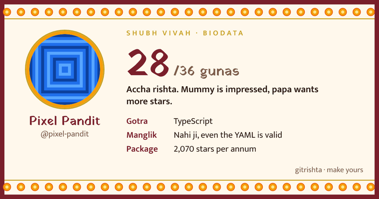

<div align="center">

# 💍 GitRishta

**Your GitHub profile, as a proper Indian shaadi biodata.**

Gotra: JavaScript. Manglik: uses tabs over spaces. Seeking: someone who reviews PRs on time.

[](https://github.com/alphasafal/gitrishta/actions/workflows/ci.yml)
[](https://github.com/alphasafal/gitrishta/actions/workflows/codeql.yml)
[](LICENSE)

### [Make your biodata →](https://gitrishta.vercel.app)


</div>

## What you get

- **Biodata**: type a username and get gotra, rashi, nakshatra, manglik status, package (in stars), family background and expectations.
- **Kundli Milan 💞**: match two developers out of 36 gunas across five kootas (languages, commit hours, licenses, activity, stars), with common ground and Pandit ji's advice.
- **Wedding styles**: North (marigold), South (mango-leaf thoranam), Bengali (red and white) and Punjabi (phulkari), plus Hindi labels.
- **Made to share**: link previews that show the person's own biodata, Print / Save PDF on one A4 page, a PNG download, WhatsApp text, and a badge for your GitHub profile README.

<p align="center"></p>

## Share links

| Link | Shows |
|---|---|
| `gitrishta.vercel.app/s/<user>` | A biodata, with a per-user link preview |
| `gitrishta.vercel.app/s/<user>/<other>` | A Kundli Milan |
| `?t=south` · `?l=hi` | A wedding style · Hindi labels |

<p align="center"></p>

## How the fields are worked out

Every line comes from public GitHub data. The same username always gets the same biodata.

| Field | Source |
|---|---|
| Janm tithi · Rashi | Account creation date |
| Gotra | Most-used language in your own repos |
| Nakshatra | Your peak commit hour (IST), from recent public pushes |
| Height | Number of public repos |
| Package | Total stars on your own repos |
| Bhai-behen | Forked repos |
| Jaaydaad | Your oldest repo |
| Family values | Most common license |
| Gunas | Stars, followers, recent activity, repos and how complete your profile is |

Manglik, education, parents, hobbies and expectations come from [`src/jokes.ts`](src/jokes.ts), seeded by your username.

## Privacy

The biodata is built in your browser, which talks to `api.github.com` directly. There are no accounts and no cookies. Page views are counted with Vercel Web Analytics with the query string removed, so usernames are never recorded. Link-preview images are drawn on the server from the same public data and cached for a day.

## Run it locally

```bash
git clone https://github.com/alphasafal/gitrishta.git
cd gitrishta
npm ci
npm run dev            # http://localhost:5173 (use `npx vercel dev` for /s/ and /api/og)
npm test               # unit and security tests
npx playwright test    # browser and accessibility tests
```

Requires Node 22+. Optional server settings are in [`.env.example`](.env.example).

## How it's built

- **App**: TypeScript and Vite, no framework. Runtime dependencies: two self-hosted fonts, `html-to-image` for the PNG export and `@vercel/analytics`.
- **Edge functions**: `/s/<user>` serves per-user link previews; `/api/og` draws the 1200×630 preview as an SVG template and rasterises it with resvg.
- **Hosting**: Vercel. `main` deploys to production, and every pull request gets its own preview URL.
- **CI**: typecheck, unit tests, build, `npm audit`, Playwright tests with axe accessibility checks, CodeQL, dependency review and Dependabot. Actions are pinned to commit SHAs with least-privilege tokens.

## Add a joke 🙏

The jokes all live in one file: [`src/jokes.ts`](src/jokes.ts). Add a line and open a PR, or [suggest one in an issue](https://github.com/alphasafal/gitrishta/issues/new?template=joke.yml).

One rule: we roast code habits, never people.

## Security

Strict CSP with Trusted Types, every piece of GitHub data rendered as text, HTML-escaped server pages, and pinned, scoped avatar fetching. See [SECURITY.md](SECURITY.md) to report an issue privately.

## License

[MIT](LICENSE) © Safal Gupta. Fonts: [SIL OFL 1.1](assets/fonts/README.md).
