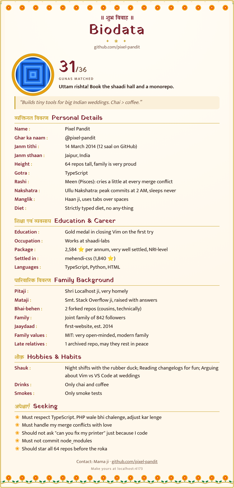

<div align="center">

# 💍 GitRishta

**Your GitHub profile, as a proper Indian shaadi biodata.**

Gotra: JavaScript. Manglik: uses tabs over spaces. Seeking: someone who reviews PRs on time.

[](https://github.com/alphasafal/gitrishta/actions/workflows/ci.yml)
[](https://github.com/alphasafal/gitrishta/actions/workflows/codeql.yml)
[](LICENSE)

### [Make your biodata →](https://alphasafal.github.io/gitrishta/)



</div>

## What you get

- **Biodata**: type a username and get a full matrimonial biodata with gotra, rashi, nakshatra, manglik status, package (in stars), family background and expectations.
- **Kundli Milan 💞**: match two developers and get a score out of 36 gunas, based on shared languages, commit hours, licenses, activity and stars.
- **Print / Save PDF**: an A4 layout that fits on one page, ready for the family WhatsApp group.
- **Download image**: a crisp PNG for X, LinkedIn and Instagram stories.
- **Share links**: `?u=torvalds` for a biodata, `?u=alice&m=bob` for a kundli match.

<p align="center"></p>

## How the fields are worked out

Every line comes from your public GitHub data. The same username always gets the same biodata.

| Field | Source |
|---|---|
| Janm tithi | Account creation date |
| Rashi | Zodiac sign of that date |
| Gotra | Most-used language in your own repos |
| Nakshatra | Your peak commit hour (IST), from recent public pushes |
| Height | Number of public repos |
| Package | Total stars on your own repos |
| Bhai-behen | Forked repos |
| Jaaydaad | Your oldest repo |
| Family values | Most common license |
| Gunas | Stars, followers, recent activity, repos and how complete your profile is |

Manglik, education, parents and hobbies are picked from [`src/jokes.ts`](src/jokes.ts), seeded by your username.

## Privacy

Everything runs in your browser. Your browser talks to `api.github.com` directly, with no server in between, no cookies, no analytics and no storage. Only public profile data is read. GitHub allows 60 lookups an hour per visitor without sign-in, which is plenty for this.

## Run it locally

```bash
git clone https://github.com/alphasafal/gitrishta.git
cd gitrishta
npm ci
npm run dev      # http://localhost:5173
npm test         # unit and security tests
npm run build    # static site in dist/
```

Requires Node 22+. The only runtime dependencies are two self-hosted font packages and `html-to-image` for the PNG export.

## Add a joke 🙏

The best part of this project is the jokes, and they all live in one file: [`src/jokes.ts`](src/jokes.ts). Add a line, open a PR. Or [suggest one in an issue](https://github.com/alphasafal/gitrishta/issues/new?template=joke.yml).

One rule: we roast code habits, never people.

## Security

The page has a strict Content Security Policy with Trusted Types, renders all GitHub data as plain text, and only links to `https` URLs. Actions are pinned to commit SHAs with least-privilege tokens. See [SECURITY.md](SECURITY.md) to report an issue privately.

## License

[MIT](LICENSE) © Safal Gupta
